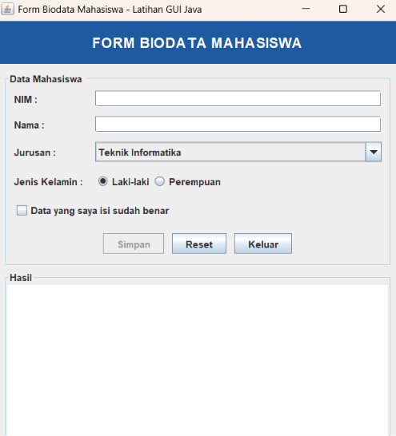
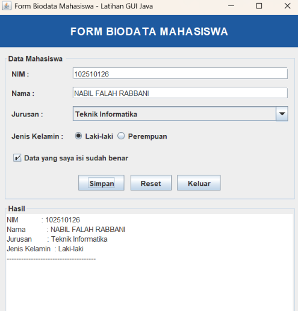
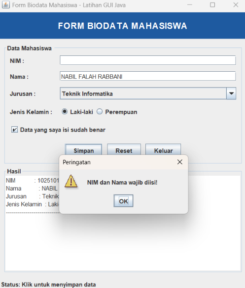

# Latihan / Eksplorasi GUI Java (Swing) — Form Biodata Mahasiswa

Tugas **3C - Latihan/Eksplorasi Materi Graphical User Interface pada Java**.

| | |
|---|---|
| **NIM** | `ISI_NIM_KAMU` |
| **Nama** | `ISI_NAMA_KAMU` |

## Deskripsi Singkat
Aplikasi desktop sederhana berbasis **Java Swing** untuk mengisi biodata mahasiswa
(NIM, nama, jurusan, jenis kelamin). Data yang disimpan akan tampil pada area hasil.

## Informasi 5 Komponen Utama GUI yang Digunakan

### 1. Top-level Container Class — `JFrame`
Jendela utama aplikasi. Semua komponen lain diletakkan di dalamnya.
```java
public class FormBiodataMahasiswa extends JFrame { ... }
```

### 2. Intermediate Container Class — `JPanel` dan `JScrollPane`
Wadah perantara untuk mengelompokkan komponen. Digunakan `panelJudul`, `panelForm`,
`panelGender`, `panelTombol`, `panelTengah`, `panelStatus`, dan `JScrollPane`
yang membungkus `JTextArea`.

### 3. Atomic Component Class
Komponen paling dasar yang berinteraksi langsung dengan pengguna:

| Class | Fungsi |
|---|---|
| `JLabel` | Teks keterangan / judul |
| `JTextField` | Input NIM dan Nama |
| `JComboBox` | Pilihan Jurusan |
| `JRadioButton` + `ButtonGroup` | Pilihan Jenis Kelamin |
| `JCheckBox` | Persetujuan kebenaran data |
| `JButton` | Tombol Simpan, Reset, Keluar |
| `JTextArea` | Menampilkan hasil data |

### 4. Layout Classes (3 layout)
| Layout | Digunakan pada |
|---|---|
| `BorderLayout` | `JFrame` (NORTH = judul, CENTER = form & hasil, SOUTH = status bar) |
| `GridBagLayout` | `panelForm` (susunan label dan input berbentuk grid) |
| `FlowLayout` | `panelJudul`, `panelGender`, `panelTombol`, `panelStatus` |

### 5. Event Listener
| Listener | Jenis | Method yang di-override | Fungsi |
|---|---|---|---|
| `ActionListener` | Interface | `actionPerformed()` | Aksi tombol Simpan, Reset, Keluar |
| `ItemListener` | Interface | `itemStateChanged()` | Tombol Simpan aktif jika checkbox dicentang |
| `WindowAdapter` | Adapter Class | `windowClosing()` | Konfirmasi saat jendela ditutup |
| `MouseAdapter` | Adapter Class | `mouseEntered()`, `mouseExited()` | Status bar berubah saat kursor di atas tombol Simpan |
| `KeyAdapter` | Adapter Class | `keyTyped()` | NIM hanya boleh diisi angka |

## Cara Menjalankan
Pastikan **JDK 8+** sudah terpasang.

```bash
# compile
javac -d out src/FormBiodataMahasiswa.java

# jalankan
java -cp out FormBiodataMahasiswa
```
Atau buka folder ini di IntelliJ IDEA / NetBeans / VS Code lalu jalankan `FormBiodataMahasiswa.java`.

## Screenshot

**Tampilan awal**



**Setelah data disimpan**



**Validasi / peringatan**



## Struktur Repositori
```
latihan-gui-java/
├── src/
│   └── FormBiodataMahasiswa.java
├── screenshots/
│   ├── 01-tampilan-awal.png
│   ├── 02-setelah-simpan.png
│   └── 03-validasi.png
├── .gitignore
└── README.md
```
